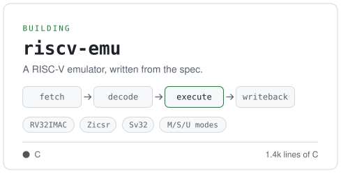
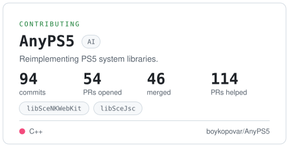
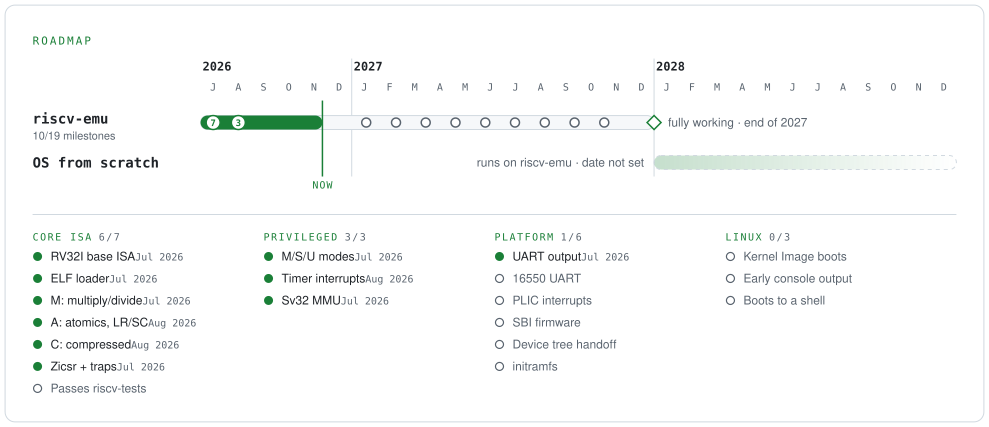

<picture>
  <source media="(prefers-color-scheme: dark)" srcset="assets/banner-dark.svg" />
  
</picture>
<a href="https://github.com/c1b3r-p3d1a/riscv-emu"><picture><source media="(prefers-color-scheme: dark)" srcset="assets/cards/riscv-dark-ad4137b1.svg" /></picture></a><a href="https://github.com/boykopovar/AnyPS5/pulls?q=is%3Apr+author%3Ac1b3r-p3d1a+is%3Amerged"><picture><source media="(prefers-color-scheme: dark)" srcset="assets/cards/anyps5-dark-1b6daf3e.svg" /></picture></a>

<picture>
  <source media="(prefers-color-scheme: dark)" srcset="assets/cards/timeline-dark-08ceb95b.svg" />
  
</picture>

<picture>
  <source media="(prefers-color-scheme: dark)" srcset="assets/stack-dark.svg" />
  
</picture>
